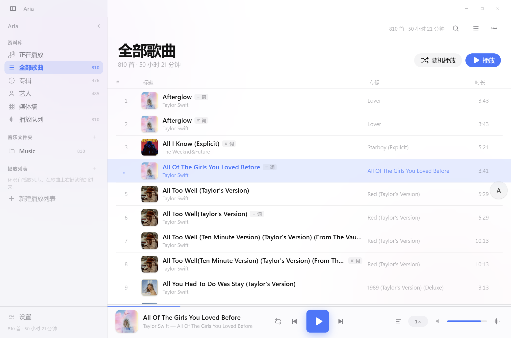
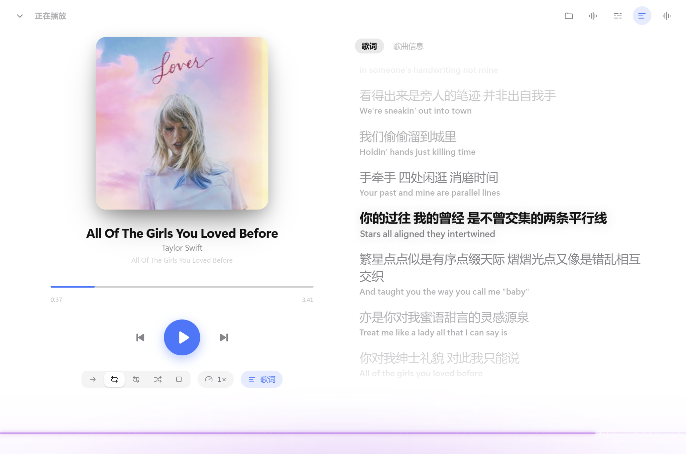
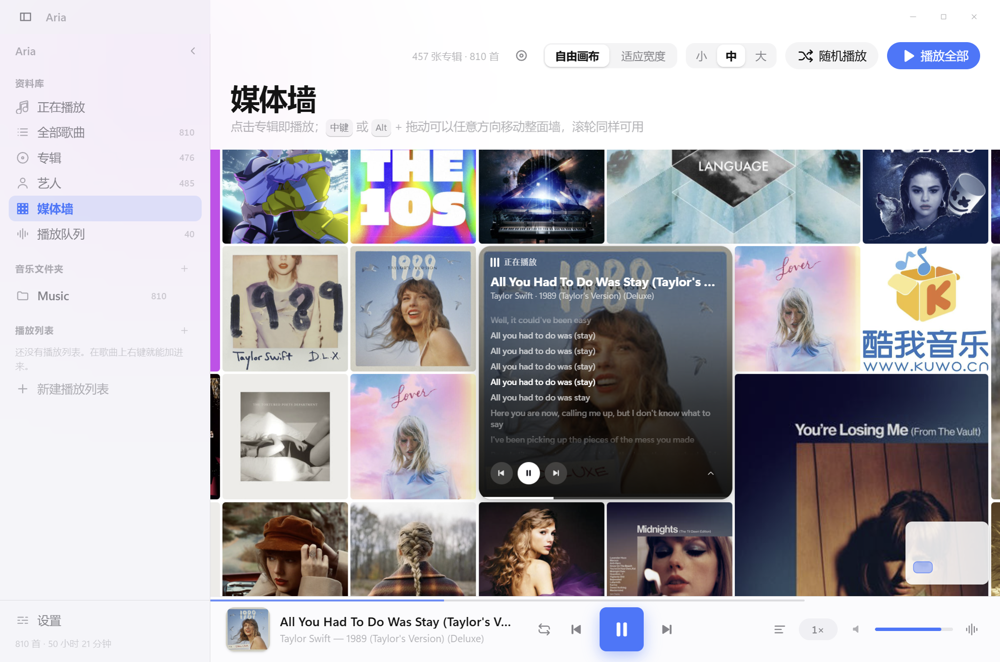
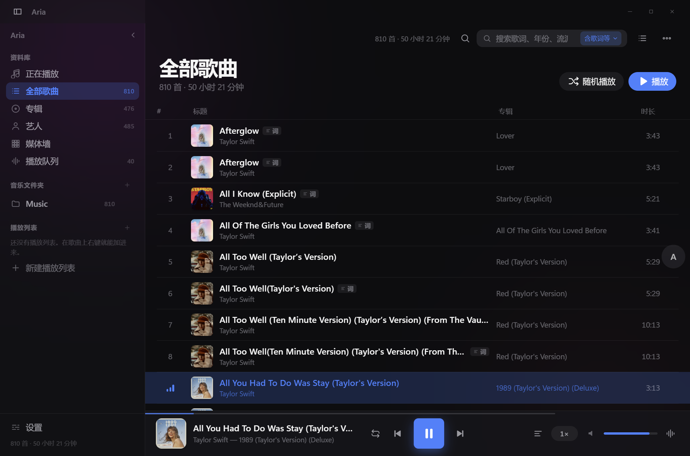

# Aria

[中文](README.md) | **English**

A local music player for Windows and macOS with an iOS-flavoured interface. Electron shell,
**no build step** (the renderer is plain ES modules), no account, no telemetry, no bundled content.

  

> Version lives in `package.json`. Still pre-1.0: data structures and internal APIs may change.

## Screenshots

| Library | Now playing |
| --- | --- |
|  |  |

| Media wall | Dark mode |
| --- | --- |
|  |  |

## Three products, one codebase

Same source, three identities. The only difference is **which capabilities get mounted at launch**
(services / plugins / sidebar):

| Product | What it is | How you launch it |
| --- | --- | --- |
| **Aria** | Full app: library, albums/artists, media wall, online metadata, tray | Click the icon |
| **Aria Player** | Lightweight player: no library, plays "opened files" only | Double-click an audio file |
| **Aria Unified** | One installer, two modes: **icon = full, double-click audio = player** | Depends on whether argv contains a real audio file |

Each product/mode has its **own `userData` directory** and its own single-instance lock, so they can run
side by side. Only Aria Player and Aria Unified register file associations — the full app never hijacks
"double-click .mp3".

### AI subtitles (local)

When a song has no `.lrc`, a **local** model can transcribe the lyrics and their timing.
Recognition runs entirely on your machine and never uploads audio; the only time the app
goes online for this feature is when **you** press "Download model" (about 229 MB, once).

- Off by default ("Settings → AI subtitles"). After the download it works fully offline.
- Line-level timing comes from silero VAD speech segments; when VAD finds nothing it falls
  back to fixed 15–20 second windows and the UI says the timing is estimated.
- Results are cached per track (path + mtime + model fingerprint), 200 entries at most.
- Two models, both **downloaded on demand** and **never bundled with the installer**:
  - SenseVoice-small (int8) — **FunASR MODEL_LICENSE**, a custom model licence
    (not an OSI-approved licence): <https://github.com/modelscope/FunASR/blob/main/MODEL_LICENSE>
  - silero VAD — **MIT**: <https://github.com/snakers4/silero-vad/blob/master/LICENSE>
- Optional post-processing (both off by default) can send the **lyric text only** — never audio —
  to an OpenAI-compatible endpoint you configure yourself.

## Auto-update

A packaged build checks GitHub Releases about 20 seconds after launch (never blocking startup).
Settings → About has **Check for updates**: a new version is downloaded automatically with progress,
and the button turns into **Restart and install** once it is ready. With no update it says
"up to date"; failed *automatic* checks only go to the log, and a failed *manual* check reports one
short sentence instead of a dialog storm.

Publishing must include `latest.yml` (electron-builder writes it into `release*/`) — without it
electron-updater fails with `Cannot find latest.yml` (which is exactly what 0.1.x ran into).

> Unsigned builds **can** update (NSIS does not verify signatures), but the first launch is still
> stopped by **SmartScreen**; on macOS **Gatekeeper** blocks unsigned/unnotarised builds until you
> allow them in Privacy & Security.

## Crash logs and the diagnostics bundle

The main process logs to `<userData>/logs/main.log` (rotating at 512 KB) and starts Electron's
crashReporter, whose dumps stay in `<userData>/crashes` — **nothing is uploaded anywhere**. Uncaught
exceptions and unhandled rejections are logged instead of popping dialogs.

Log lines are redacted **as they are written**: API keys (`sk-…`, `Bearer …`, `api_key=…`),
credentials inside URLs, and user-home paths (`C:\Users\<name>`, `/home/<name>`, `/Users/<name>`).

Settings → About → **Export diagnostics** produces a zip with `info.json` (versions, OS, arch),
a redacted `settings.json`, the last 200 log lines, the last self-check result, and a short README.
It never contains audio, lyrics, artwork, keys, or full user paths.

## Track context menu

Right-click any track:

- **Show in folder** — reveals the file in Explorer/Finder (`shell.showItemInFolder`);
- **Copy file path** — puts the absolute path on the clipboard.

Both apply to **local files only**: online sources have no local path, so those two entries are
disabled; if the file has been moved or deleted you get an explicit "the file is gone" message
instead of a silent no-op.

## Resume positions

On by default (Settings → Equaliser → **Remember playback position**). While playing, the position is
saved every 5 seconds; less than 5 seconds in is not worth saving, and being within 10 seconds of the
end counts as "finished" and is not saved either. **On end the entry is deleted**, so the next play
starts from zero.

- Stored in `<userData>/resume.json`, capped at **500 tracks** (oldest dropped first).
- Coming back to a track resumes where you left off (with a short "resuming at m:ss" toast).
- Turning the switch off stops all reads and writes of that file.

## Volume normalisation (ReplayGain)

Some albums are mastered loud, some quiet. "Settings → Equaliser → Volume normalisation" reads the
ReplayGain tags (`REPLAYGAIN_TRACK_GAIN` / `REPLAYGAIN_ALBUM_GAIN` / `REPLAYGAIN_TRACK_PEAK`) and
applies a per-track GainNode so everything sits at a similar level:

- **Off** (default): fully bypassed — no audio graph is created, the playback path is identical to before.
- **Track**: each track's own gain.
- **Album**: prefer the album gain, fall back to the track gain.

It never touches your own volume slider. Untagged tracks play at 0 dB, and absurd tag values
(beyond ±24 dB) are treated as 0 dB.

## Install / build / self-check

```bash
npm ci                  # reproducible install (package-lock.json is committed)
npm start               # run the app
npm run fixtures        # generate the wav fixtures used for manual testing (tests/ is not committed)
npm run check           # 13 static checks (fast, safe for CI)
npm run smoke           # UI self-check: needs a desktop session and a real music folder

npm run dist            # Aria         → release/Aria-Setup-<version>.exe      + Aria-<version>-portable.exe
npm run dist:player     # Aria Player  → release-player/
npm run dist:unified    # Aria Unified → release-unified/
```

`npm run smoke` opens real windows, takes the single-instance lock, simulates drag & drop and even moves
the OS cursor — **it cannot run in CI**. Close every running Aria instance first. CI only runs
`npm ci && npm run check` (see `.github/workflows/check.yml`).

## Unsigned builds

Release binaries are **not code-signed**. Windows SmartScreen shows "Windows protected your PC" →
*More info* → *Run anyway*. macOS Gatekeeper refuses the first launch → right-click the app → *Open*,
or `xattr -dr com.apple.quarantine /Applications/Aria.app`. On Apple Silicon an unsigned build may report
"damaged"; the repo's pack script applies an ad-hoc signature (`scripts/mac-adhoc-sign.js`).

## Legal

- **No content is provided.** The repository contains no audio, no artwork and no lyrics, and ships no
  online sources. Online sources are scripts *you* import yourself.
- For personal use and learning only. Play files you own or are allowed to use.
- Online features are **OFF by default** — the master switch, online lyrics, online covers and online
  artist avatars all start disabled. The app is fully usable offline. Turn the master switch on yourself if
  you want LRCLIB lyrics or iTunes/Deezer covers; the UI states which services it will contact. Requests come
  from your machine; nothing is proxied or collected.
- Not affiliated with Apple Inc. "iOS"/"macOS"/"Windows" are mentioned only to describe compatibility.

## Contributing

See [CONTRIBUTING.md](CONTRIBUTING.md) (in Chinese), [CODE_OF_CONDUCT.md](CODE_OF_CONDUCT.md) and
[SECURITY.md](SECURITY.md). The self-checks are the contract: never relax an assertion.

## License

[MIT](LICENSE) © 2026 deepseek, 8左边的白马6.
Third-party dependencies and assets: see [THIRD-PARTY-NOTICES.md](THIRD-PARTY-NOTICES.md).
