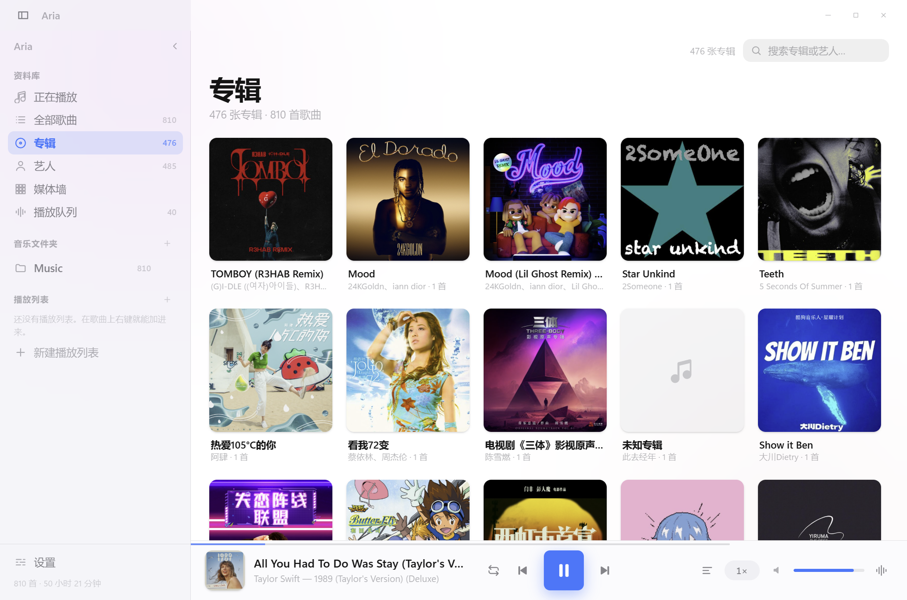
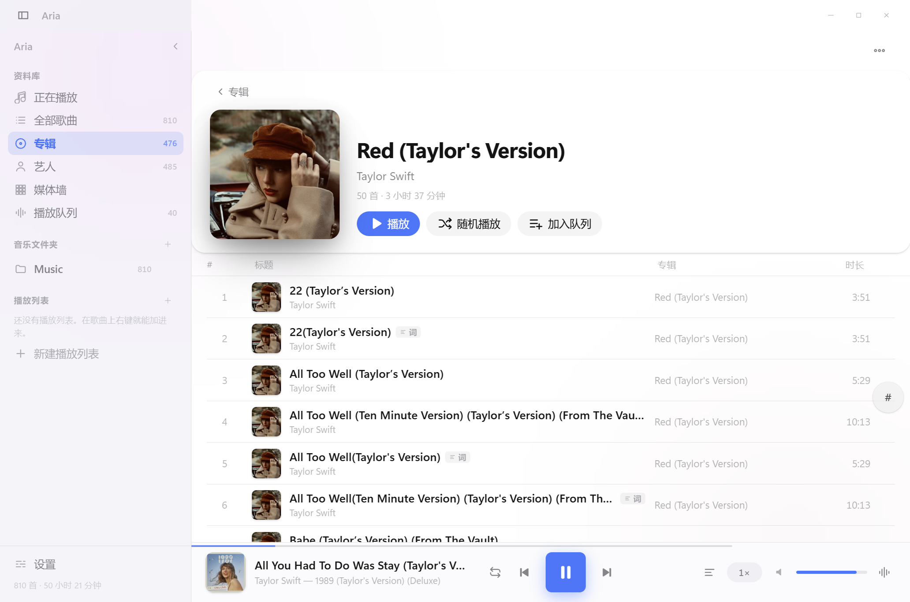
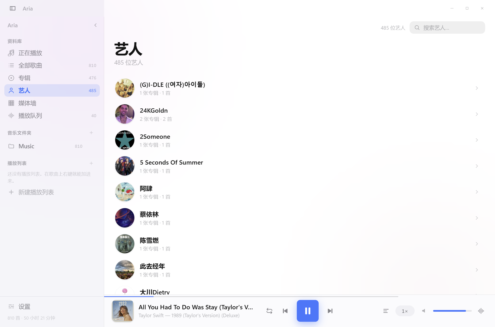
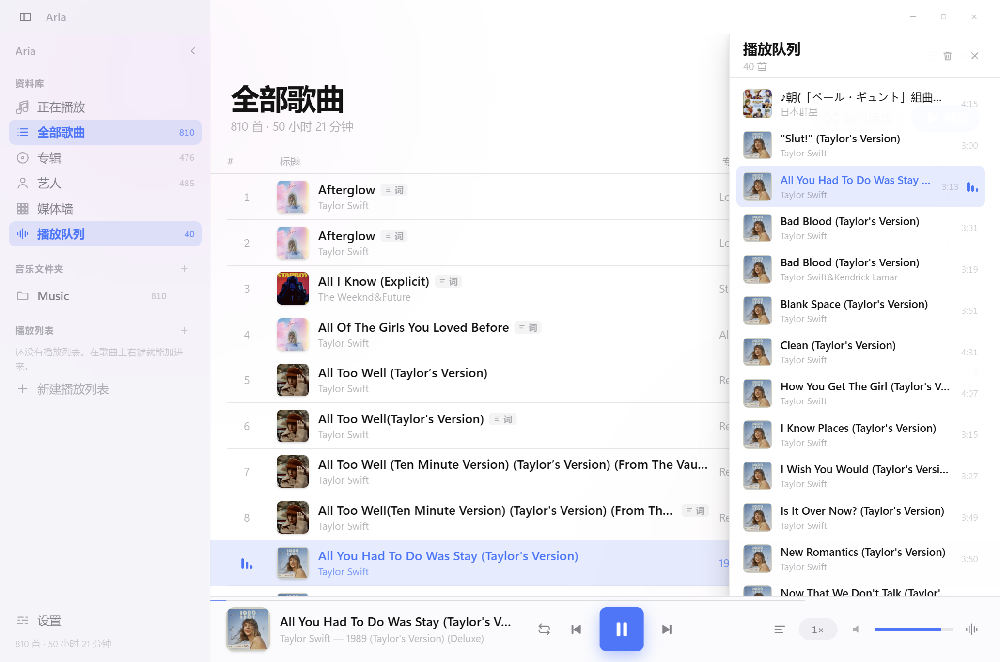
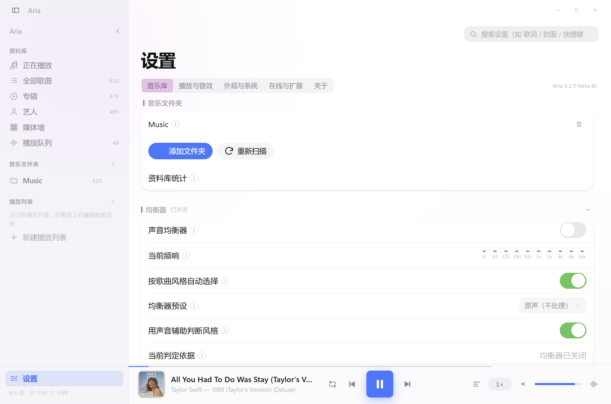
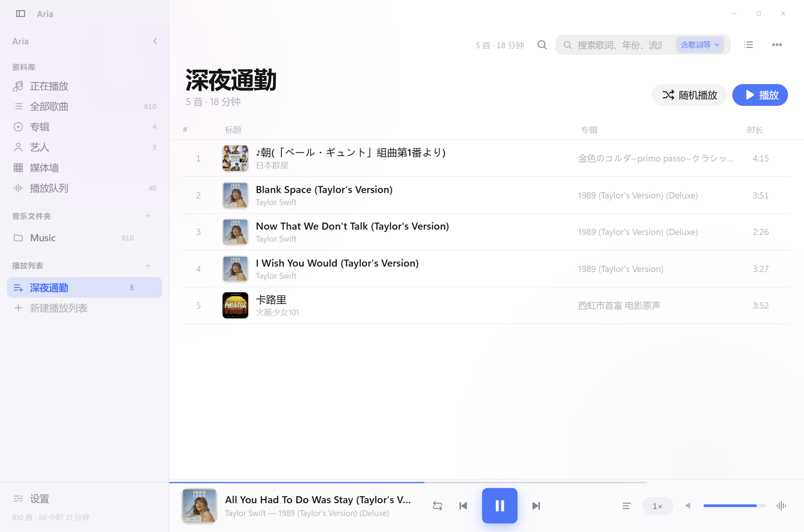
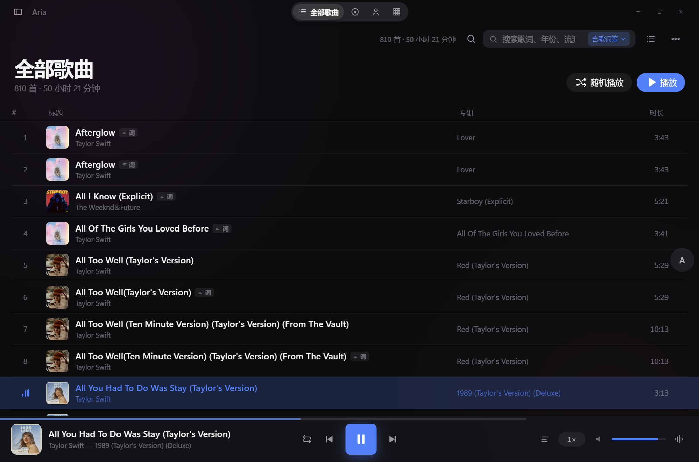
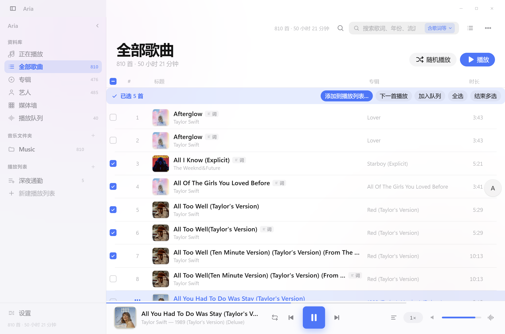
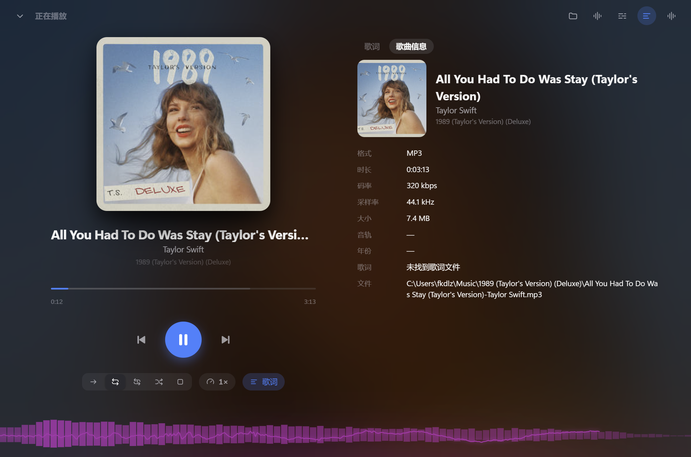

# Aria

**中文** | [English](README.en.md)

iOS 设计风格的本地音乐播放器，Electron 套壳，零构建步骤（原生 ES Module）。

 

> 版本见 `package.json`：开发中，尚未发布正式版本，接口与数据结构仍可能变动。

## 三个产品

同一份代码，三个身份、三个安装包 —— **区别只在启动时挂哪些能力**（服务 / 插件 / 侧栏）：

| 产品 | 是什么 | 怎么进 |
| --- | --- | --- |
| **Aria** | 完整版：资料库、专辑/艺人、媒体墙、在线补全、托盘 | 点图标 |
| **Aria Player** | 轻量播放器：没有资料库，只播「打开的文件」 | 双击音频文件 / 点图标 |
| **Aria Unified** | 一个安装包两种模式：**点图标 = 完整版，双击音频 = 轻量播放器** | 看命令行里有没有真实存在的音频文件 |

三者的 `userData` 完全分开（`Aria` / `Aria Player (player)` / `Aria Unified (full)` / `Aria Unified (player)`），
互不共享单实例锁，可以同时开着。只有 Aria Player 与 Aria Unified 注册文件关联；Aria 本体不抢「双击 .mp3」。

## 界面

| 歌曲列表 | 正在播放与歌词 |
| --- | --- |
|  |  |

| 专辑网格 | 专辑详情 |
| --- | --- |
|  |  |

| 媒体墙 | 艺人 |
| --- | --- |
|  |  |

| 播放队列 | 设置 |
| --- | --- |
|  |  |

| 自建播放列表 | 深色下的灵动岛（收起侧栏） |
| --- | --- |
|  |  |

| 批量选择歌曲 |
| --- |
|  |

深色主题：

| 歌曲列表 | 正在播放与歌词 |
| --- | --- |
|  |  |

> 界面会跟着当前**封面**变色：`--tint` 默认从封面取样（按 `艺人|专辑` 缓存，同一张专辑恒定），
> 取不到色、过灰或过白时自动回退到「艺人 | 专辑」哈希出的稳定配色；
> 也可以在设置 → 外观 →「主题色来源」里固定用稳定配色。
> 背景模糊图、底部光晕、示波器、选项框选中态读的都是同一个 `--tint`，所以永远同色系。

## 功能

- **资料库**：递归扫描本地音乐目录，读取 ID3 / MP4 / FLAC / Vorbis 元数据与内嵌封面（`music-metadata`，缺失时自动降级到内置 ID3 解析器）
- **浏览**：歌曲列表（虚拟滚动，几万首不卡）、专辑网格、艺人列表、媒体墙（满屏封面马赛克，三档尺寸），专辑/艺人详情页支持整张播放、随机播放、加入队列
- **媒体墙聚焦**：正在播放的那张专辑**就在自己的位置上**跨 2×2 放大成聚焦块（模糊封面打底 + 曲目信息 + 同步滚动的迷你歌词 + 传输控件 + 进度条），周围的封面顺延让路；切换尺寸、聚焦块换位都走 FLIP 过渡，整墙平滑推移而不是硬跳
- **媒体墙自由画布**：网格铺成一块比窗口更大的二维平面（列数按专辑数算，接近视口比例），
  **中键拖动**或 **Alt + 左键拖动**可以横竖斜任意方向移动整面墙，滚轮/触控板同样可用；
  松手带惯性滑行（按真实时间衰减，低帧率机器手感一致）、越界有橡皮筋阻尼并回弹，
  右下角有位置指示器（可点可拖）；也可以切回「适应宽度」布局（铺满窗口宽度、只竖向移动）
- **播放**：顺序播放、列表循环、单曲循环、随机播放，暂停 / 上一曲 / 下一曲 / 进度条拖动与缓冲显示
- **歌词**：自动匹配同名或「歌名-歌手」`.lrc`，逐行跟随滚动、双语翻译行、逐字（卡拉 OK）高亮、手动滚动后「回到当前」、偏移与字号调节，支持 GBK/UTF-8/UTF-16 编码探测与内嵌歌词。
  歌词可以**抓住上下拖动**：跟随时内容靠 `transform` 推到正中，手动滚动一开始就把它折成原生 `scrollTop`（视觉不动），所以上下两个方向都能翻（见 [docs/DESIGN.md](docs/DESIGN.md) 里的「滚动」一节）
- **自建播放列表**：侧栏「播放列表」一栏里点 + 或「新建播放列表」新建（可重命名、删除），
  在任意歌曲上右键 →「添加到播放列表…」就能加进来（已在列表里的不会重复加）。
  打开列表后，标题、曲目顺序都是你自己的：
  默认**不按艺人/专辑重排**，除非你显式选一个排序方式；列表里的曲目永远按 id 存，
  文件改名或重扫后自动跟上，被删掉的曲目会安静地跳过
- **声音均衡器**：设置 → 播放 → 声音均衡器。四组预设取自 `data.json`  （古典/交响、摇滚/金属、流行/人声、电子/舞曲），每组是一条完整的 Web Audio 链：
  十段均衡 → 压缩 → 饱和 → 中侧声场 → 混响，外加低频增强。
  **「按歌曲风格自动选择」**会从曲目的流派字段（以及标题/专辑里的线索）判断风格并自动切换，
  认不出来就用你手动选的那一组；总开关与自动开关在设置里都能关掉。
  数据里没能如实实现的部分（LUFS 响度归一、多段/并联压缩、crossfeed 与 HRIR）已在
  `core/equalizer-presets.js` 顶部写明原因 —— 不做「看起来有其实没有」的东西。
- **沉浸式示波器**：正在播放页**底部那条**是音频可视化 —— 镜像频谱 + 示波器波形（默认）、
  纯波形、环形频谱三种画法，点顶栏那颗波形图标循环切换，再点一次就是**关闭**。
  取色跟着专辑（`--tint`），深浅色主题下都各自量过。它是一条**纯装饰层**（`pointer-events: none`），
  而且整条落在底部工具条**下方**，所以不会挡住任何控件；面板关掉就停止绘帧，暂停时降到约 6 帧。
  数据走 WebAudio 的 `AnalyserNode`（与均衡器同一条链）—— 因此**只在真的要画的时候**
  才创建接入点，选「关闭」时一个节点都不建，播放路径保持原生。
- **批量选择**：多选是一个**单独的动作**，平时列表里**没有任何勾选框**，也不会点着点着就
  进去了。入口是列表右上角的 **「⋯」→ 选择多个歌曲**（也可以在某首歌上右键 →
  「开始多选」）。进入多选模式之后：整个列表的勾选框才出现，**选中的打勾、没选的空着**，
  点行就是勾选 / 取消勾选，一眼看得见自己勾了哪几首。也支持 `Ctrl/⌘ + 点击` 加选、
  `Shift + 点击` 选一整段、`Ctrl+A` 全选、`Esc` 退出（设置页的「快捷键」里也列了）。
  表头那颗是全选 / 取消全选（部分选中时显示成短横）。选中两首以上时列表上方会出现一条
  工具条：**添加到播放列表…** / 下一首播放 / 加入队列 / 全选 / 结束多选；
  在已选中的歌上右键也会切成批量菜单（「已选中 N 首」）
- **搜索的相关度**：艺人 / 专辑列表在搜索时会把**名字命中查询的排在前面**，
  再按字母序。合作曲目拆分之后（见下一条），搜「taylor」会把 Bon Iver、Ed Sheeran
  这些合作方也带进艺人列表 —— 按字母序它们可能排到 Taylor Swift 本人前面
- **播放的「上下文」就是当前这一页**：从专辑详情播放就以整张专辑为队列，从艺人详情就以该艺人的曲目为队列，
  媒体墙上点哪张专辑就以那张专辑为队列，从文件夹 / 搜索 / 自建播放列表点歌同理 ——
  队列面板显示的永远是你点播的那一页
- **搜索**：两档范围 —— **歌曲信息**（歌名 / 专辑 / 艺人，纯内存匹配，输入即出结果）与
  **含歌词等**（再加上歌词文件、年份、流派、文件名、所在文件夹、编码格式、码率与无损/有损）。
  范围随时在搜索框里切换，右侧还会显示速度与解析背景；搜索框里带 **最近搜索**（回车或点开结果即记录，
  自动去重，最多 10 条，可单条移除或清空），全部持久化到设置里
- **变速**：0.5× – 2×（步进 0.05），可开关「保持音调」
- **系统集成**：托盘图标与菜单、关闭窗口最小化到托盘、任务栏进度条与缩略图按钮（上一首/播放/下一首）、系统媒体键、Windows 系统媒体弹窗（含封面）
- **自动同步**：可开启目录监听，音乐文件夹里增删文件后按扩展名过滤 + 防抖自动刷新资料库；把文件夹或歌曲直接拖进窗口即可导入/播放
- **在线补全（默认关闭）**：**总开关默认是关的** —— 打开之后才会向 LRCLIB 补歌词、向 iTunes / Deezer 补 600×600 封面（封面还有一道自己的分项开关）。全部请求由主进程发出，页面本身仍然不能联网，结果缓存在本地
- **网络代理**（设置 → 在线与扩展）：**跟随系统**（默认）/ **直连** / **手动** 三种。
  起因是「开了加速器还是取不到封面/头像」—— 不少加速器并不设置系统代理，
  而在线请求默认跟随系统代理，于是等于没有代理：这时切成「手动」填它的地址（如 `http://127.0.0.1:7890`）即可。
  一处生效全都走（歌词 / 封面 / 艺人头像都由主进程的默认会话发出）；默认值与改动前一致，不设代理的人不受影响
- **在线音源（默认关闭，且不内置音源）**：提供的是「音源脚本宿主」——把 `.js` 音源脚本**从链接导入**、
  从本地文件导入，或直接放进 `<userData>/music-sources`，搜索时结果就会分成两块：
  **网络结果**（音源返回）与**本地结果**（原有的歌曲列表）。每条网络结果都能**直接播放**
  （解析直链后在内置播放器里播，歌词跟着加载）、**下载**（默认目录或设置里指定的目录）、
  复制地址；多音源可以批量启用/停用、逐条开关、看调用统计，**单个音源出错不影响其他音源**。
  脚本跑在独立线程的 QuickJS/WASM 解释器里，只给受限的 `request` / `crypto` / `zlib` / `Buffer` / 定时器，
  没有 `require`、`fs`、`process`。没有音源时「网络结果」那一块不会出现 ——
  接口说明见 [docs/EXTENDING.md](docs/EXTENDING.md)
- **设置页的组织**：五个子标题（音乐库 / 播放与音效 / 外观与系统 / 在线与扩展 / 关于），
  每个子标题下的设置分块**按子标题顺序自上而下排列**（不并排、不会被裁掉）。
  点子标题会平滑滚到对应那一块并把它**顶到最上面**，子标题自身高亮；
  手动滚动时高亮跟着当前所在的那一块走。工具栏右侧有**设置内搜索**：
  一个词同时匹配设置项标题、说明文字与**分组名**（搜「封面缓存」「在线音源」也能找到），
  命中的行以专辑色淡底标出、命中的分组标题吃专辑色，并显示匹配数量，
  回车在命中项之间循环跳转、`Esc` 清空（`Ctrl + F` 也能直接聚焦到这里）；搜过的词进**设置页自己的**最近搜索（与歌曲页的历史分开存，互不挤占），
  可以点一条重搜、单条移除或一键清空 —— 它只作用于设置页，不会过滤资料库
- **界面**：iOS/macOS 风格 —— 毛玻璃材质、分组列表、大标题收起、iOS 开关 / 分段控件 / 滑块、按专辑稳定的动态配色、正在播放全屏页
- **导航**：侧边栏可以收起（标题栏按钮 / 侧栏头部按钮 / `Ctrl+B`），收起后由标题栏正中的
  **灵动岛**接管视图切换（平时只显示当前视图，指向它才展开全部文字）——两者不会同时出现。
  侧边栏里的四个视图项**可以拖动排序**，其它标签跟着滑动，顺序持久化，灵动岛同步跟着变
- **艺人合并 / 拆分**：合作曲目按真实写法拆开 ——「Taylor Swift&Brendon Urie」同时出现在
  两位艺人名下，而「Tungevaag & Raaban」「W&W」「Tones And I」这类乐队名一个都不拆
- **省内存**：最小化或收进托盘后释放媒体墙 DOM、封面缓存与目录监听，回前台自动重建（见「性能」）

### 颜色来源（`--tint`）

界面里所有"跟着封面变"的颜色只有一个来源：根元素上的 `--tint` / `--tint-2` / `--tint-soft`
（写入点是 `artwork.applyTint`）。正在播放页的背景模糊图上还叠了一层 30% 的同色色调，
所以**背景、光晕、示波器、设置页选中态不会各走各的颜色**。

取色规则（设置 → 外观 →「主题色来源」，默认「封面」）：

- **封面**：逐像素取样（按饱和度加权算色相，平均饱和/亮度用来把住质量）；
  同一张专辑按 `艺人|专辑` 缓存 —— 切走再切回颜色不变；
- **回退**：没有封面、取不到像素、平均饱和 < 0.12（黑白摄影）、平均亮度 > 0.85 或 < 0.08（大面积白底/全黑）
  → 换成「艺人 | 专辑」哈希出的稳定配色，并记住这次回退（不反复重试同一张坏图）；
- **稳定配色**：不联网、不看封面，纯按名字哈希 —— 颜色一定整齐、可复现。

颜色变化有 240ms 过渡（`@property` 注册成 `<color>`）；开了「减少动画」就不做过渡。

### AI 字幕（本地）

歌没有 `.lrc` 时，可以让**本机**模型听出歌词与时间轴 —— 识别完全在本机跑、不上传音频；
只有你主动点「下载模型」时才会联网获取模型（一次约 229 MB，之后不再联网）。

- **默认关闭**。在「设置 → AI 字幕」里打开，才会去下载模型（SenseVoice-small int8，约 229 MB
  + silero VAD 0.6 MB，只需一次）；之后**完全离线**。
- 歌词页空状态会出现「用 AI 生成本地字幕」：先下载（有进度、可取消、断网可续传），
  再在后台进程里识别（可取消，不影响播放）。
- 结果按行显示，带徽章「AI · 本地」和「识别可能有误」。时间轴优先来自 VAD 切出的语音段；
  切不出段时退化成 15–20 秒定窗，界面上会写「时间轴为估算」。
- 识别结果按「路径 + 修改时间 + 模型指纹」缓存（上限 200 条 / 20 MB），同一首歌第二次直接命中。
- 模型可以随时「删除模型」清干净；字幕缓存也能一键清空。
- 两个模型都**不随安装包分发**，只在你点「下载模型」时获取，许可各自独立：
  SenseVoice-small 用的是 **FunASR MODEL_LICENSE**（自定义模型许可，**不是 OSI 认证的开源许可**，
  <https://github.com/modelscope/FunASR/blob/main/MODEL_LICENSE>）；
  silero VAD 是 **MIT**（<https://github.com/snakers4/silero-vad/blob/master/LICENSE>）。
  详见 [THIRD-PARTY-NOTICES.md](THIRD-PARTY-NOTICES.md)。
- 解码用的是浏览器自带的解码器（mp3 / m4a / flac / wav / ogg / opus / aac）；
  wma / aiff 这类解不开的格式会明确告诉你先转格式。

## 重复曲目检测

设置 → 关于 → **检查重复曲目**。两段式，避免对整库算哈希：

1. **初筛**：按「文件大小 + 时长（±1 秒）」分组 —— 完全相同的文件一定同组；
2. **判重**：同组内算**内容指纹**（首 64KB + 末 64KB + 大小的 SHA1）—— 指纹相同 → **完全重复**。

另外单独一组「**可能重复**」：同艺人 + 同标题 + 时长接近，但**大小不同**（不同码率/来源）——
这类**不会**被当成完全重复，免得你误以为文件一模一样。

**只报告，不删任何文件**；分组每一项都带路径，界面上可以直接播放第一份去听。

### AI 字幕：VAD 随包内置，模型按需下载

- `silero_vad.onnx`（**643,854 字节**，SHA256 `9e2449…1fd6`）**随安装包分发**，只给
  Aria Player / Aria Unified（本体不做 AI 字幕）。所以"删掉模型目录"之后 VAD 仍然就绪，
  设置页照常显示 VAD 已就绪。
- SenseVoice（约 229MB）**仍然按需下载**，下载源与 SHA256 都没变，校验失败会删掉重下。

### 用 Ollama 全本地做校正/翻译

「AI 校正」「AI 翻译」走的是 OpenAI 兼容接口，本地跑的 Ollama 就是一个：

```bash
ollama serve                      # 默认监听 127.0.0.1:11434
ollama pull qwen2.5:7b            # 或者任何你喜欢的模型
```

然后在「设置 → 外部模型」里填：

| 字段 | 值 |
| --- | --- |
| 接口地址 | `http://127.0.0.1:11434/v1` |
| 模型名 | `qwen2.5:7b`（跟你 pull 的那个一致）|
| 密钥 | 留空（本地模型不需要）|

这样从识别到校正/翻译**全在本地**完成，一个字节都不出网。注意：本地小模型的改写质量
不如大模型，效果不好时把「AI 翻译」关掉只留「AI 校正」更稳。

## 自动更新

打好的包会在启动 20 秒后（不阻塞启动）去 GitHub Releases 查一次更新，设置 → 关于里有
**「检查更新」**：发现新版本会自动下载并显示进度，下完按钮变成 **「重启安装」**。
没有更新时明确显示「已是最新版本」；自动检查失败只写日志，手动检查失败才给一句
「网络不可用，稍后再试」，不会弹窗轰炸。

更新源是 `electron-builder.base.yml` 里的：

```yaml
publish:
  provider: github
  owner: 8hourseontheleft6
  repo: aria-player
```

**发版时必须把 `latest.yml` 一起传上去**（electron-builder 会生成在 `release*/` 里）——
没有它，electron-updater 会报 `Cannot find latest.yml`（0.1.x 就踩过这个坑）。

> 未签名的包**也能走更新流程**（NSIS 不校验签名），但首次运行仍会被 **SmartScreen** 拦一下；
> macOS 会撞 **Gatekeeper**（未签名/未公证），需要在「隐私与安全性」里手动允许。

## 崩溃日志与诊断包

主进程会把日志写进 `<userData>/logs/main.log`（超过 512KB 滚一份 `main.log.1`），
同时开着 Electron 的 crashReporter（dump 只落在 `<userData>/crashes`，**不往任何服务器上传**）。
未捕获的异常与未处理的 Promise 拒绝都会进日志，不会弹窗轰炸。

日志在**写入时**就脱敏：外部模型的 key（`sk-…`、`Bearer …`、`api_key=…`）、URL 里的
`user:pass@`、以及 `C:\Users\<名字>` / `/home/<名字>` / `/Users/<名字>` 这类路径。

设置 → 关于 → **导出诊断包** 会生成一个 zip：

| 条目 | 内容 |
| --- | --- |
| `info.json` | 版本、Electron/Chromium/Node、OS、架构、locale、启动时间 |
| `settings.json` | 脱敏后的设置（**不含** AI key，只有 `hasKey`）|
| `logs/main.log` | 最近 200 行日志（已脱敏）|
| `selfcheck.json` | 最近一次自检的结果（跑过才有）|
| `README.txt` | 这个包是什么 |

**不含**音频、歌词、封面、密钥、完整的用户名路径。导完会直接在资源管理器里定位到文件。

## 无缝播放（预加载下一首）

设置 → 均衡器 → **无缝播放（预加载下一首）**，默认关闭。打开后，当前曲目一开播就把
下一首的字节用一个隐藏的 `Audio` 预读进来（`preload="auto"`），换歌时读的是本地缓存，
起播更快、缝更小。关掉时**完全不预热**，播放路径与以前一模一样。

**诚实的边界**：这是"预加载 + 快速接手"，**不是采样级 gapless**。真正的无缝要在
WebAudio 里把两首解码成 `AudioBuffer` 排程播放，那会绕开现在的 `<audio>` 链路
（均衡器、可视化、倍速都挂在那条链上），属于另一次重构。当前实现保证：
失败就退回普通切歌，不会把播放卡住。

## 队列拖动排序

打开播放队列（右下角按钮或快捷键），直接**按住一首往上/下拖**就能换位置：

- 过中线才换位（阈值 5px 起步，跟侧栏的拖动是同一套手感）；
- **当前曲目不会错位** —— 重排后游标对回的是同一首歌，不会变成旁边那首；
- 松手即写进设置（`queue`），下次启动按这个顺序恢复；库里已经删掉的曲目会被跳过。

## 曲目右键菜单

在任意曲目上右键：

- **在文件夹中显示** —— 用系统资源管理器定位到文件（`shell.showItemInFolder`）；
- **复制文件路径** —— 复制绝对路径到剪贴板。

两项都只对**本地文件**生效：在线音源没有本地路径，菜单里这两项是灰的；
文件如果已经被移走或删掉，会明确提示「文件不在了（可能被移动或删除）」，不会静默失败。

## 续播（记住每首歌的位置）

默认开启（设置 → 均衡器 → **记住每首歌的播放位置** 可关）。播放中每 5 秒记一次，
听满 5 秒才值得记，离结束不到 10 秒就当听完了不记；**播完立刻删掉**这条，下次从头开始。

- 记录存在 `<userData>/resume.json`，**最多 500 首**，超了按时间丢最旧的；
- 切歌/退出后再放同一首，会从上次的位置继续（并提示「从上次的位置 m:ss 继续」）；
- 关掉开关后**完全不再读写**这个文件。

## 音量归一化（ReplayGain）

有些专辑压得响、有些压得轻，连着听就得一直拧音量。开启「设置 → 均衡器 → 音量归一化」后会读曲目里的
ReplayGain 标签（`REPLAYGAIN_TRACK_GAIN` / `REPLAYGAIN_ALBUM_GAIN` / `REPLAYGAIN_TRACK_PEAK`），
用一个 GainNode 把每首歌拉到同一响度：

- **关**（默认）：完全旁路，不创建音频图，播放路径与没有这个功能时完全一致。
- **单曲**：用每首歌自己的增益。
- **专辑**：优先用整张专辑的增益；这张专辑没有标签就退回单曲。

它只改「这首歌的响度」，**不改你的音量滑杆**；没有标签的曲目按 0dB 处理；
标签值超过 ±24dB 一律当 0dB（那种值一定是标签写错了）。

## 安装 / 构建 / 自检

```bash
# 依赖：仓库里有 package-lock.json，用 ci（可复现；npm install 也能装，但可能在别人机器上装出别的版本）
npm ci

# 起应用
npm start              # = electron .
npm run dev            # 起应用并打开开发者工具

# 夹具：自检与手工试听用的 wav（tests/ 不进仓库，按需生成）
npm run fixtures

# 静态检查：13 步
npm run check

# 后端回归：通信、密钥、配置恢复、缓存与音源隔离（无需 GUI）
npm run test:backend

# 界面自检（需要 GUI；见下面的注意事项）
npm run smoke                                              # 本体
npx electron . --smoke --profile=player                    # Aria Player 那套
npx electron . --smoke <某个音频文件>                        # 模拟"双击文件"进播放器
ARIA_PRODUCT=unified npx electron . --smoke                # Aria Unified 的完整版那一侧
ARIA_PRODUCT=unified npx electron . --smoke <某个音频文件>   # Unified 的播放器那一侧

# 出包（产物在 release* /，不进仓库）
npm run dist           # Aria         → release/Aria-Setup-<版本>.exe + Aria-<版本>-portable.exe
npm run dist:player    # Aria Player  → release-player/
npm run dist:unified   # Aria Unified → release-unified/
```

**`npm run smoke` 的注意事项（重要：它不能在 CI 里跑）：**

- 要**真窗口**：会起 GUI、抢单实例锁、模拟拖放与真实拖动（连系统光标都挪）；
- 跑之前把已开的 Aria（三个产品都算）**全部关掉**，否则新实例会被单实例锁挡掉、检查读不到窗口；
- 本体那 200 多条需要**一个真实的音乐文件夹**（默认 `%USERPROFILE%\Music`）；播放器与 Unified 的套件是自包含的；
- CI（`.github/workflows/check.yml`）只跑 `npm ci + npm run check`。

> 如果 shell 里带着 `ELECTRON_RUN_AS_NODE=1`（有些工具链会设置），`electron .` 会退化成
> 普通 Node 启动并报 `Cannot read properties of undefined (reading 'commandLine')`。
> 先 `set ELECTRON_RUN_AS_NODE=`（或 PowerShell 里 `$env:ELECTRON_RUN_AS_NODE=''`）再启动。
> 这条对**打包后的 exe** 同样成立：exe 会以 Node 身份跑完就退出，看上去"双击没反应"。

> 如果 `npm ci` 阶段 Electron 二进制下载失败（网络受限），可以手动把已缓存的
> `%LOCALAPPDATA%\electron\Cache\electron-v<版本>-win32-x64.zip` 解压到
> `node_modules/electron/dist`，并在 `node_modules/electron/path.txt` 写入 `electron.exe`。

首次启动会自动把系统音乐目录加入资料库并扫描；之后启动只做增量刷新（文件未变则只 stat，秒开）。

## 未签名构建

发布包**没有代码签名**（个人项目，没买证书），所以系统会拦一下 —— 这是预期行为，不是装坏了：

- **Windows**：首次运行会出现蓝色的「Windows 已保护你的电脑」（SmartScreen）。
  点「更多信息」→「仍要运行」。之后同一份文件不再提示。
  若被当成病毒隔离：文件属性里勾「解除锁定」（`Unblock-File`）再运行。
- **macOS**：第一次打开会提示「无法打开，因为 Apple 无法检查是否包含恶意软件」。
  三种放行方式：右键点图标 →「打开」→ 再点「打开」；或「系统设置 → 隐私与安全性」底部点「仍要打开」；
  或终端里 `xattr -dr com.apple.quarantine /Applications/Aria.app`。
  Apple Silicon 上没签名的应用会报「已损坏」—— 打包脚本里有一条 ad-hoc 签名（`scripts/mac-adhoc-sign.js`），
  用仓库里的命令自己打就不会遇到这条。

不放心的话：自己 `npm ci && npm run dist` 打一份，或者只跑源码（`npm start`）。

## 开发工具

这几个脚本都是无人值守的，退出码可直接用于 CI：

```bash
npm run smoke            # 完整链路自检（资料库→播放→seek→变速→队列→模式→歌词→搜索→音源→协议→界面→浏览→系统集成→监听→在线补全）
npm run perf             # 帧率诊断：逐视图量 rAF 间隔 + 拖动路径 A/B 对照（见「性能」一节）
npm run audit            # 视觉审计：计算样式 / 几何 / 截图位图统计，输出 docs/screenshots/audit.json
npm run shots            # 生成 docs/screenshots/ 下的界面截图
npm run probe -- "D:\Music" 20   # 命令行探针：直接验证元数据与歌词解析（不启动 Electron）
node scripts/probes/probe-lyrics.js "D:\Music" 3
                         # 歌词探针：打印双语歌词的解析结果（主歌词 / 翻译 / 迷你歌词各显示什么）
node scripts/probes/probe-artists.js "D:\Music"
                         # 艺人字段探针：列出资料库里所有「一个字段塞了多个艺人」的写法，
                         # 按分隔符分组统计（拆分规则就是照着它的输出定的，见 core/grouping.js）
npm run check            # 一次跑完下面三条静态检查
node scripts/checks/check-imports.js    # 找出未使用的 import
node scripts/checks/check-injected.js   # 校验 smoke 里注入到渲染层的代码片段能否解析
                                 # （注入代码写在模板字符串里，多一个括号很难肉眼发现）
node scripts/checks/check-styles.js     # 设计语言守卫：圆角/阴影是否走令牌、var() 是否有定义、
                                 # 亮暗两套主题的令牌是否成对（见 docs/DESIGN.md）
npx electron scripts/preview.js docs/screenshots/01-library.png 104
                         # 把截图转成文本预览（结构图 + 色相图），无图形界面时也能审版面
```

> 如果 `npm run smoke` 长时间**没有任何输出**（连开头的标题都不打印），通常是自动化配置目录
> 被写坏了 —— 多见于「自检运行中强制结束 electron」。删掉 `%TEMP%\aria-dev-profile` 后重跑即可，
> 目录会自动重建（首次会重新扫库，所以第一轮偏慢）。

界面改动请先读 **[docs/DESIGN.md](docs/DESIGN.md)** —— 间距/圆角/阴影/动效的规则
与例外都在那里，能自动检查的部分由 `check-styles` 兜住。

动手之前也建议读一遍 **[docs/CONVENTIONS.md](docs/CONVENTIONS.md)**：提交粒度、
验证顺序（check → smoke → shots，且要真的看图）、改文件的规矩（为什么不要用
`node -e` / PowerShell 改文件）、代码约定（先声明后使用、rect 而不是 offsetTop、
页面内搜索不写 `ui.query`…）以及这一路踩过的环境坑。

## 性能

### 拖动的每帧开销（媒体墙）

整面墙是一块比窗口大得多的二维平面（474 张专辑 ≈ 4382×2570 CSS px，@1.75x 就是 7669×4498
设备像素）。拖动时如果让浏览器每帧把整面墙都栅格化一遍，实测只有 **16fps**。

现在的做法很朴素：**平移直接作用在平面上，同时让屏幕外的格子不参与绘制**
（`.wall-tile.is-culled { visibility: hidden }`，行列从当前位移直接算，不读 DOM）。

为什么用 `visibility` 而不是别的：

- 不能用 `display: none` —— 那会让网格重新自动填充，整面墙每次都要重排；
- 也不能靠**裁剪**（把网格的盒子收成视口大小 + `overflow: hidden`）——
  这一版真的这么写过，而且当时量出来是 12ms/帧（83fps），看起来非常成功。
  但裁剪域会跟着 transform 一起移动，于是**只有平面左上角那一屏看得见，拖到别处整片空白**；
  那次「变快」其实是因为画面上几乎什么都不剩。后来靠命中测试（`elementFromPoint`）
  才发现：在墙视口里取 24 个点，命中率为 0。

实测（`npm run perf`，同一轮里改 CSS 做 A/B，排除环境波动）：

| 做法 | 每帧 | 备注 |
| --- | --- | --- |
| 屏幕外的格子 `visibility: hidden` | **8.35ms（120fps）** | 与空载基准持平，画面完整 |
| 关掉这条（所有格子都参与绘制） | 61.94ms（16fps） | 对照项，说明这一条到底省了什么 |

脚本还会顺带确认「JS 只有 0.015ms/帧」，把瓶颈锁定在绘制而不是脚本；
量出的空闲基准是 8.4ms/帧（120fps 上限），可以判断某次卡顿到底是环境节流还是这一档真有开销。

### 自检里为什么要有「命中测试」
DOM 上的 `getBoundingClientRect()` 相交**不能**说明元素真的看得见：被祖先 `overflow: hidden`
裁掉、或者被判定为屏幕外不绘制时，rect 照样相交。上面那个「拖到别处全白」的 bug
之所以能通过当时全部 92 项自检，就是因为所有判定都建立在 rect 之上。

同样地，`element.click()` 也说明不了「点得到」—— 被裁掉、被别的层压住的元素
照样能被程序化点击触发。搜索面板与全屏播放页里的队列面板都栽在这上面：

- 搜索面板挂在 `.search` 内部，而 `.search` 为收起动画带着 `overflow: hidden`
  且展开后没解除 → 面板被整个裁掉，用户看到的是「只能搜歌曲信息，切不了范围」；
- 队列面板的 `z-index` 高于播放页（45 > 40）却仍然被压住 —— 因为 `.app` 自己就是一个
  `z-index: 1` 的层叠上下文，整个 app 子树都在播放页下面。修法是全屏时把队列面板
  挂进播放页里（`mountQueuePanel()`），跟它同层。

所以媒体墙、搜索面板、全屏播放页里的队列都各自有一条「命中测试」：
在元素的中心点调 `elementFromPoint`，要求命中的确实是它自己；范围切换那条还会
派发完整的 `pointerdown/mousedown/pointerup/mouseup/click` 序列，而不是 `element.click()`。


现在媒体墙有一条专门的检查：在墙视口里取 24 个点做 `elementFromPoint`，
要求绝大多数点能命中真实的格子（阈值 75%，留出 3px 格子缝与平面边缘的余量；
出问题时的量级完全不同 —— 那一版实测是 0）。
截图脚本也会等封面真正加载完再截，避免留下「一整面占位图」的文档。

### 最小化之后的内存

最小化（或收进托盘）超过 4 秒后，应用会主动把「能重建的东西」全丢掉，回到前台再建：

| 丢掉 | 留在内存里 |
| --- | --- |
| 媒体墙的 474 个格子（约 4000 个 DOM 节点） | 音频本身 —— 最小化还在放歌 |
| 120 张封面的 blob 缓存（解码后每张接近 1MB） | 曲目元数据（重建要全盘扫描） |
| 在线搜索 / 歌词深搜的结果 | 正在播放的封面（已解码在 `` 里） |
| 后台封面预热的定时器 | 用户设置、播放队列 |
| 一直最小化超过 45 秒后：目录监听（Windows 上每个 watcher 占一个线程），回来时重新监听并做一次增量扫描 | |

实测（`npm run smoke` 里的「最小化」两项）：整页 DOM 20332 → 16305 个节点，内存
1514MB → 1297MB，播放进度从 2s 连续走到 8.6s 没有断。

两条踩过的坑都写进了代码注释：释放的顺序必须是「先清会触发 store 变更的东西，最后拆媒体墙」
（反过来的话，清 store 引起的那次 `refresh()` 会把刚拆掉的墙立刻重建回来），
而且媒体墙在释放期间要拒绝重建，否则最小化时的一次资料库扫描就能把 474 个格子搬回来。

关于「杀掉不必要的进程」：Chromium 自己的 GPU / 网络 / 音频 utility 进程不能单独杀 ——
它们由 Chromium 管理，杀掉要么直接崩、要么立刻重启（渲染进程更是界面本身）。
所以这里落实的是「停掉不必要的工作」，而不是真的去 kill 进程。

### 帧率浮层

设置 → 外观 → **显示帧率**，右下角会实时显示「帧率 · 平均帧耗时 · 最近两秒最差的一帧」。
卡与不卡最终取决于用户机器的 GPU、驱动与刷新率，开发机上的数字不能替用户下结论，
所以留了一个能自己看的入口（默认关闭，关掉时不会留下任何每帧回调）。

### 首次打开的封面加载

媒体墙一屏就有上百张封面，最容易出问题的是「首次打开时的封面加载风暴」。这里做了四层处理：

1. **渲染层节流**：封面请求同时最多 4 个在途、每帧最多启动 3 个，不会一次性发起上百个 IPC
2. **主进程落盘缓存**：内嵌封面第一次读取时就缩到 480px、转成 JPEG（约 45KB）存到
   `%APPDATA%\Aria\artwork-cache`，之后只读小文件；源文件 mtime 变化会自动失效
   （实测冷读 15ms → 热读 1ms）
3. **空闲时后台预热**：资料库就绪后一张一张把封面灌进缓存，界面在要封面或正在切歌加载时自动让路
4. **少建 DOM**：几百个格子的占位图标改用 CSS 绘制，省下近千个 SVG 节点

拖动手势期间还会暂停封面懒加载的 IntersectionObserver（容器每帧都在移动，否则浏览器要
为几百个观察目标重算相交性），并在平移路径上完全不读 DOM。设置页里可以看到封面缓存占用并一键清空。

### 平移之后，封面要跟着补上

把裁剪挪到 `.media-wall` 上换来了帧率，但也带来过一个回退：**拖到中段之后，新露出来的格子
一直停在灰底占位图**（实测可见 129 格只有 20 格有封面，`observing` 正常、`queued` 却恒为 0）。

原因是平移只改祖先的 transform —— 纯合成操作、不触发布局，IntersectionObserver
因此不会为「因为平移而进入视口」的格子派发新的相交回调。

修法是不跟观察者较劲，而是在**平移停稳之后自己按几何补一次**：
手势恢复观察定在 180ms，兜底扫描定在最后一次平移之后 220ms，
用 `getBoundingClientRect()` 与墙视口求交，命中的节点直接送进加载队列。
代价只在停稳时付一次，并做了三层收窄：只看墙视口子树内的节点、跳过零尺寸节点、
每个节点只量一次矩形 —— 自检量到候选 318 个、入队 59 个、**耗时 1.9ms**。
自检条目「平移后新露出的格子有封面」专门盯着这件事（当前拖到对角后 88% 的可见格子有封面）。

### 媒体墙格子尺寸的两个坑（都真的犯过）

1. **不要给网格容器确定高度**。为了做裁剪曾把网格盒子收成「视口 + 一个步长」，
   于是它有了确定高度，`auto` 行被压缩去填满容器 —— 148px 的行被压成 32px。
   后果是普通格子（靠 `aspect-ratio` 仍是 148px 高）逐行重叠、每个封面只露出上一条，
   而聚焦块（跨 2 行、`aspect-ratio: auto`）高度塌成 67px，封面被 `overflow: hidden`
   裁成一条 —— 用户看到的就是「整个封面只显示一半」。
   现在 `grid-auto-rows: var(--wall-size)` 显式给行尺寸，行高与容器高度无关。
2. **「屏幕外不绘制」的状态要和布局缓存同步**。投影到行列的缓存重建时（重建 / 改密度 /
   聚焦块换位）如果一律把「已隐藏」记成 `false`，而元素上还留着上一次的 `is-culled` 类，
   之后就不会再写样式，那些格子会永久隐藏 —— 表现是拖回原点后画面里出现整条空带。
   所以缓存重建时是从元素的类里读回真实状态。
   这两个坑现在都由自检盯着（格子是正方形 / 聚焦块正好 2×2 / 行节奏不重叠 / 封面铺满格子）。


### 搜索的两档范围

| 档位 | 匹配范围 | 代价 |
| --- | --- | --- |
| 歌曲信息 | 歌名 / 专辑 / 艺人 / 专辑艺人 | 纯内存，输入即出结果 |
| 含歌词等 | 上面这些 + **歌词文件** + 年份 / 流派 / 文件名 / 所在文件夹 / 路径 / 编码格式 / 码率 / 采样率 / 有无损 | 歌词那部分要问主进程 |

歌词不在渲染层：全库几百个 `.lrc` 由主进程读一遍并按 mtime 缓存（实测首次 266 份 649ms，
之后同一个词只要 15ms）。渲染层这边做了防抖，并且**给结果打上关键词**才交给列表 ——
搜索是异步的，输入过程中旧结果会晚到一步，不核对关键词就会闪出错误的列表。

### 搜索结果的「为什么搜到它」

默认状态下列表和平时完全一样；**鼠标悬停到某一行时**，专辑那一格会换成匹配详情：

- 歌名命中 → 标题里的命中片段高亮（不悬停时完全不留痕，保持原样）；
- 歌词命中 → 「歌词匹配」标签 + 命中的那一句，关键词高亮；
- 其他信息命中 → 「流派匹配 / 年份匹配 / 文件名匹配…」以及对应的值。

高亮用的是**用户原样输入的关键词**，不是归一化之后的：归一化会做 NFD 分解
（假名、带变音符的字母会被拆成基字符 + 组合记号），拿它去匹配原文永远匹配不上 ——
这个坑是在自检里量出来的。

命中的那一句连同时间轴一起从主进程带回来，所以**从歌词搜索结果点开歌曲时会自动跳到那一句**
（设置 → 歌词 → 「搜索到歌词时跳到那一句」可以关掉）。跳转不能立刻做：刚切歌时音频还没拿到
时长，这时 seek 会被丢掉，因此记下来等这一首就绪后再落地一次。

### 搜索框平时只留一颗图标

工具栏默认只有一颗放大镜，点击才展开输入框（`Ctrl + F` 也会展开并聚焦）；
收起时如果还留着关键词会一并清掉，避免出现「看不见却还在过滤」的状态。
范围切换与搜索历史都在展开后的下拉面板里。

几个刻意的选择：

- 多关键词之间是「与」，与原来的搜索习惯一致；
- 三处命中（歌曲信息 / 扩展字段 / 歌词）之间是「或」—— 用户输入一个词时，
  不管它出现在哪里都该被找出来；
- 搜索历史只在「真的用了一次搜索」时记录（回车、失焦、点历史条目），不是每敲一个字都记，
  否则会被 "t"/"ta"/"tay" 这种半截词塞满；
- 文件名从「歌曲信息」档里挪出去了，它属于「其他信息」，只在深度档参与匹配。

## 快捷键

| 快捷键 | 作用 |
| --- | --- |
| `空格` | 播放 / 暂停 |
| `Ctrl + ← / →` | 上一首 / 下一首 |
| `Ctrl + ↑ / ↓` | 音量 ±5% |
| `← / →` | 快退 / 快进 5 秒（正在播放页） |
| `Ctrl + L` | 打开正在播放与歌词 |
| `Ctrl + Q` | 播放队列 |
| `Ctrl + B` | 显示 / 隐藏边栏 |
| `Ctrl + O` | 添加音乐文件夹 |
| `Ctrl + F` | 搜索（歌曲 / 专辑 / 艺人页聚焦资料库搜索；设置页聚焦设置内搜索） |
| `Ctrl + M` | 静音 |
| `M` | 切换播放模式 |
| `[ / ]` | 播放速度 ±0.05×（范围 0.5–2×） |

设置页「播放」组里还有**睡眠定时器**：选 15 / 30 / 45 / 60 / 90 分钟，到点自动暂停播放、弹一句提示，行内会显示「将在 N 分钟后暂停」，下拉也自动回到「关闭」。
它是**会话内**的定时器 —— 存下来的只是"上次选的时长"，重启后不会自己开始倒计时。
| `中键拖动` | 在媒体墙里任意方向移动整面墙 |
| `Alt` + 左键拖动 | 同上（没有中键时用这个） |
| `Esc` | 关闭浮层 / 返回上一级 / 收起正在播放 |

键盘上的媒体键（播放/暂停、上一首、下一首）由主进程全局快捷键接管，可在设置里关闭。
托盘菜单、任务栏缩略图按钮与系统媒体弹窗走的是同一条指令链路（`media:command`）。

## 项目结构

```
src/
  main/                        主进程
    main.js                    组装：服务 → 协议 → IPC → 窗口
    registry.js                服务容器（主进程的扩展缝）
    protocols.js               app:// 静态资源 + media:// 流式音频（支持 Range，seek 必需）
    ipc.js                     IPC 频道与事件转发
    window.js                  无边框窗口、主题、渲染层控制台转发
    smoke.js                   --smoke 自检脚本
    services/
      settings.js              设置持久化与广播
      library.js               目录管理、递归扫描、元数据缓存、封面
      metadata.js              music-metadata 封装（含兜底）
      id3-lite.js              兜底 ID3v2/v1 解析器
      lyrics.js                歌词文件定位与编码探测
    util/                      文本解码、目录索引、MIME
  preload/preload.js           contextBridge 安全桥（频道白名单）
  renderer/
    index.html
    styles/                    tokens / base / components / shell / library / player / nowplaying / settings
    js/
      app.js                   渲染层组装（composition root）
      core/                    bus store dom icons format remote media-url artwork
                               audio-engine playlist playback-modes lrc plugin-host
                               selectors（可见曲目） grouping（专辑/艺人索引） player-controller
      ui/                      titlebar sidebar library-view browse-view media-wall
                               cover-grid track-list player-bar now-playing-panel lyrics-view
                               queue-panel settings-view slider overlay artwork-node track-menu search-box
      plugins/                 内置示例插件
```

## 扩展

不想破坏现有结构地加功能，请看 **[docs/EXTENDING.md](docs/EXTENDING.md)**。速览：

```js
// src/renderer/js/plugins/my-plugin.js
export const myPlugin = {
  id: 'my-plugin',
  name: '我的插件',
  setup (api) {
    api.register('trackAction', {
      id: 'hello',
      label: '打个招呼',
      icon: 'sparkles',
      run (track, { bus }) {
        bus.emit('ui:toast', { message: `你好，${track.title}`, type: 'success' })
      }
    })
  }
}
```

渲染层有 7 个扩展点：`playbackMode`、`panel`、`trackAction`、`lyricsProvider`、
`artworkProvider`、`themeToken`、`audioTap`；主进程侧则通过 `ctx.define(name, factory)` 注册服务。
开发者工具里 `window.__aria` 可以直接操作 store / 播放器 / 插件宿主。

## 已知边界

- Chromium 能解码的格式有限：`.mp3 .m4a .aac .flac .wav .ogg/.opus .webm`。`.wma` / `.ape` 不支持（想支持需要引入解码器，见 EXTENDING 的 `audioTap` 一节）。
- 歌词偏移采用「正值让歌词提前」的约定（`最终时间 = 标签时间 − offset`），与多数播放器一致；若你的歌词源习惯相反，负值即可。
- 在线补全只做「歌词 + 封面」，且**默认关闭**：要联网补全得在设置里自己打开总开关（打开的瞬间会写明会访问 LRCLIB / Deezer / iTunes）。所有网络请求都在主进程发出，渲染层 CSP 依然禁止联网；缓存位于 `%APPDATA%\Aria\online-cache`（设置页可一键清空）。
- 在线封面宁可空着也不放错：只有专辑名或艺人名能对上时才采用（低于阈值的匹配会被丢弃）。Deezer 在部分网络下不可达，此时会自动只用 iTunes。

（「平移后新露出的格子不加载封面」这个回退已经修掉了：原因与修法见上面的「性能 → 平移之后，封面要跟着补上」。）

## 内容与法律边界

- **本项目不提供任何内容**：仓库里没有音频、没有封面、没有歌词文本，也不内置任何在线音源。
  音源是你自己导入的脚本（设置页「在线音源」），访问什么服务、是否合规由你判断。
- **仅供个人学习与自用**：请只播放你自己拥有或有权使用的文件。因使用产生的任何版权问题与本项目无关。
- **在线功能的真实默认值**（写清楚，免得误解）：总开关 `在线功能` **默认开**，
  其中 `在线歌词` **默认开**（本地没有 `.lrc` 时会去 LRCLIB 查）、`在线封面` **默认关**。
  不想联网的话，设置里把「在线功能」关掉即可，应用完全离线也能用（资料库、播放、均衡器都不依赖网络）。
  请求由**你的机器**直接发出，本项目不代理、不上报、不收集遥测。
- **商标**：Aria 与 Apple Inc. 无任何关系，未获其背书或赞助。
  "iOS"、"macOS"、"Windows" 等名称只用于说明兼容性与设计参考；其它产品名与商标归各自所有者所有。

## License

[MIT](LICENSE) © 2026 deepseek, 8左边的白马6

第三方依赖与素材（Electron、music-metadata、图标/字体/截图等）的来源与许可见
[THIRD-PARTY-NOTICES.md](THIRD-PARTY-NOTICES.md)。

